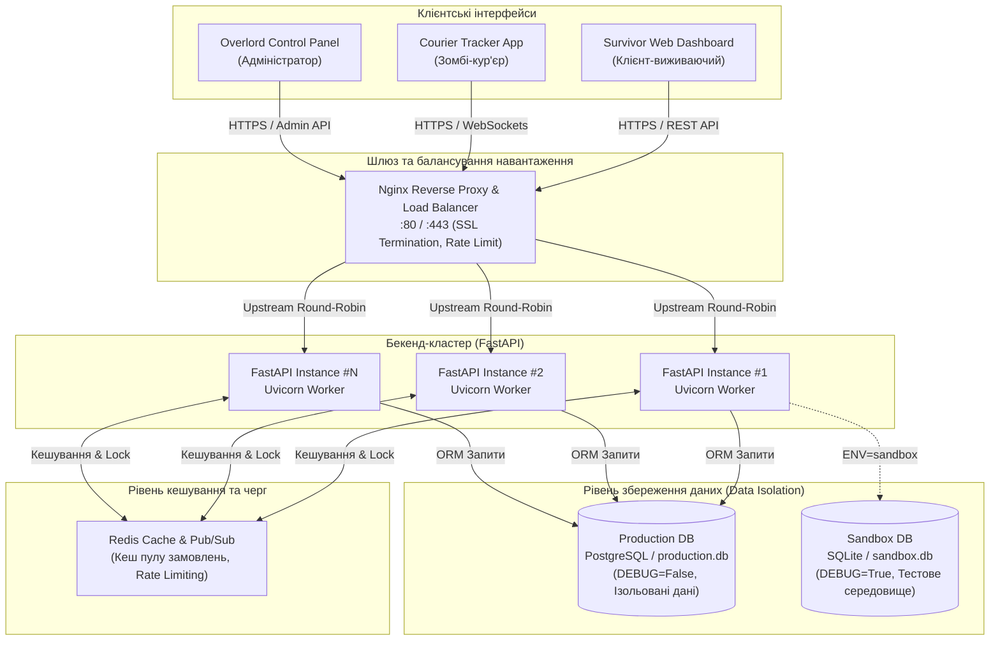
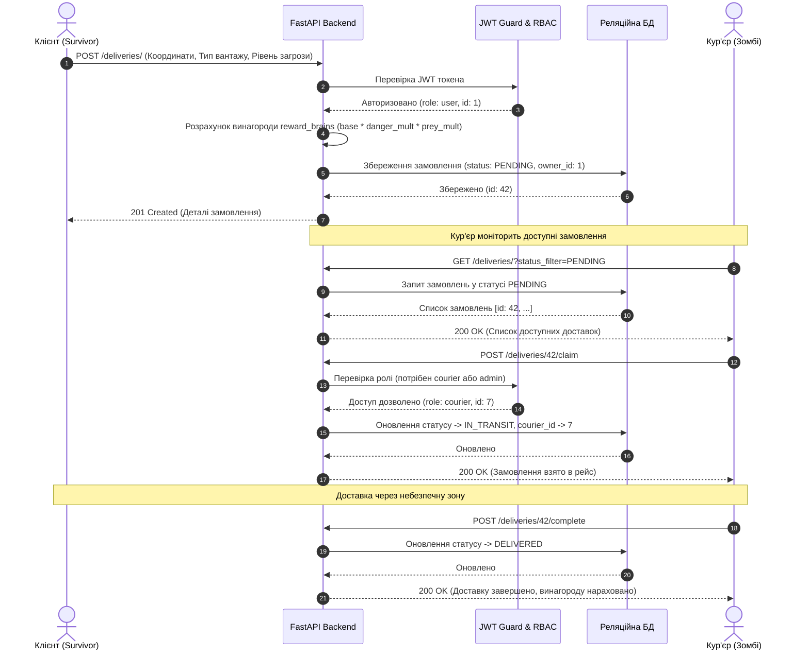

# Архітектурне проєктування системи (ЛР №1)

## 1. Загальний огляд архітектури
Проєкт побудовано за принципами багатошарової сервісної архітектури (Tiered Microservice-ready Architecture), що забезпечує високу масштабованість, ізоляцію середовищ та відмовостійкість.

Система складається з таких ключових рівнів:
1. **Клієнтський рівень (Presentation Tier)**:
   - Web UI / SPA (Single Page Application) та мобільні термінали кур'єрів.
   - REST API клієнти, Swagger UI (`/docs`), ReDoc (`/redoc`).
2. **Рівень маршрутизації та балансування (Gateway & Load Balancing Tier)**:
   - **Nginx Reverse Proxy / Load Balancer**: виконує SSL-термінацію, розподіл запитів між пулом воркерів бекенду (Round-Robin або Least-Connected), віддачу статичних файлів та первинний захист від DDoS.
3. **Рівень додатку та бізнес-логіки (Application Tier)**:
   - **FastAPI / Uvicorn Workers**: асинхронний бекенд на Python.
   - Pydantic v2 валідація вхідних даних та схем DTO.
   - JWT (JSON Web Tokens) автентифікація з рольовою моделлю доступу (RBAC).
   - Захист від IDOR (Insecure Direct Object References) на рівні бізнес-сервісів.
   - Глобальний обробник виключень із санітизацією стектрейсів у режимі `DEBUG=False`.
4. **Рівень кешування та черг (Cache & Messaging Tier)**:
   - **Redis Cache**: кешування доступних замовлень (гарячий пул для кур'єрів), rate limiting для запобігання брутфорсу паролів, сесійні блокування (Distributed Locks).
5. **Рівень збереження даних (Persistence Tier)**:
   - **Реляційна СУБД**: PostgreSQL у промисловому середовищі (Production), SQLite у пісочниці (Sandbox) та тестовому оточенні.
   - SQLAlchemy ORM для безпечної взаємодії з БД без ризику SQL Injection.

---

## 2. Схема архітектури системи (Mermaid C4 Diagram)

---

## 3. Діаграма послідовності створення та виконання замовлення (Data Flow)

---

## 4. Політика безпеки та ізоляції середовищ
1. **Розділення налаштувань**: Усі конфігурації завантажуються виключно через змінні середовища за допомогою `pydantic-settings`.
2. **Ізоляція баз даних**:
   - У тестовому середовищі (`ENV=sandbox`) застосовується `sandbox.db`.
   - У робочому середовищі (`ENV=production`) застосовується `production.db` (або виділений інстанс PostgreSQL).
3. **Захист від витоку даних при збоях (500 Error Sanitization)**:
   - При `DEBUG=False` у Production будь-яка непередбачена системна помилка перехоплюється глобальним middleware і клієнту повертається безпечна уніфікована JSON-відповідь: `{"message": "Internal Server Error (Zombie systems are down). Please contact system administrator."}`.
   - Жодні назви бібліотек, внутрішні шляхи до файлів, рядки вихідного коду чи змінні стектрейсу не потрапляють у відповідь клієнту.
4. **Захист від горизонтального підвищення привілеїв (IDOR)**:
   - Кожна операція читання (`GET /deliveries/{id}`), редагування (`PUT /deliveries/{id}`), видалення (`DELETE /deliveries/{id}`) та оновлення профілю (`PUT /users/{id}`) перевіряє право власності: `owner_id == current_user.id or current_user.is_admin`. У разі невідповідності повертається `403 Forbidden`.
